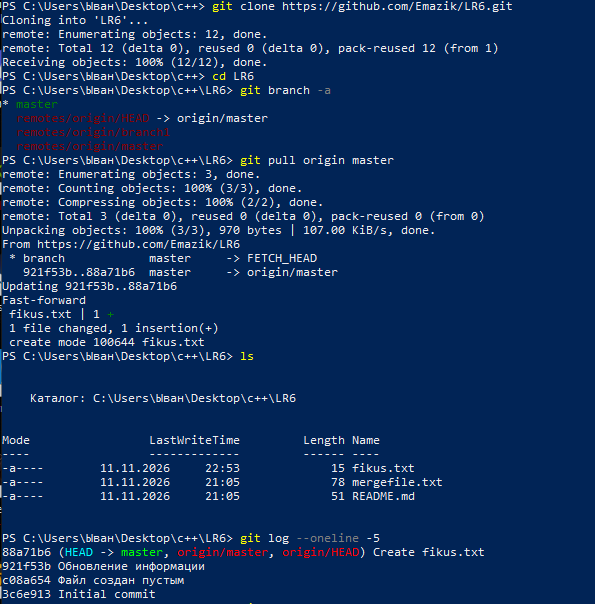
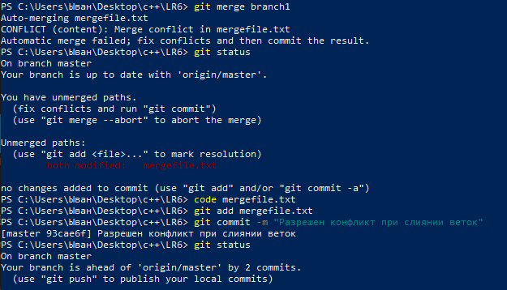
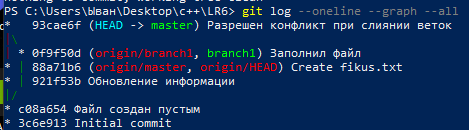

# Лабораторная работа №6. Система контроля версий

**Выполнил:** студент группы 4516 Горбань И.С.
**Дисциплина:** Системы контроля версий
**Тема:** изучение базовых возможностей системы управления версиями, работа с Git API, локальным и удалённым репозиторием.

**Используемое ПО:**

* Git for Windows (клиент командной строки `git`);
* GitHub — удалённое хранилище репозитория;
* Windows PowerShell — консоль;
* Visual Studio Code / «Блокнот» — редактирование файлов и разрешение конфликтов.

**Репозиторий:** <https://github.com/Emazik/LR6>

---

## 1. Цель работы

Изучить базовые возможности системы управления версиями Git, получить опыт работы с Git API, а также с локальным и удалённым репозиторием.

## 2. Постановка задачи

1. Создать аккаунт на GitHub.
2. Сделать копию (Fork) репозитория <https://github.com/Kurtyanik/LR6/> в личное хранилище.
3. Установить Git.
4. Настроить клиент Git: имя пользователя (группа и Ф.И.О.) и email.
5. Клонировать личный удалённый репозиторий на компьютер.
6. Добавить файл через веб-интерфейс GitHub и подтянуть изменения в локальный репозиторий.
7. Получить историю операций для каждой из веток.
8. Просмотреть последние изменения.
9. Выполнить слияние в ветку `master`, разрешив конфликт.
10. Удалить побочную ветку после успешного слияния.
11. Несколько раз изменить файлы и зафиксировать изменения с комментариями.
12. Сделать откат коммита.
13. Создать ветку для отчёта.
14. Оформить отчёт в `README.md` с использованием синтаксиса Markdown, со скриншотами и логом команд.
15. Получить историю операций в форматированном виде и добавить её в отчёт.
16. Отправить локальные изменения в GitHub.

---

## 3. Ход работы

### 3.1. Клонирование репозитория

После установки Git был настроен клиент (имя пользователя и email). Личный репозиторий, полученный через Fork, склонирован на компьютер, после чего просмотрены список веток и журнал коммитов.



В удалённом репозитории присутствуют две ветки: `master` и `branch1`. После добавления файла `fikus.txt` через веб-интерфейс GitHub изменения были подтянуты в локальный репозиторий командой `git pull origin master` (fast-forward).

### 3.2. История операций по веткам

История просматривалась отдельно для каждой ветки: `git log master --oneline` и `git log branch1 --oneline`. Так как ветка `branch1` существовала только в удалённом репозитории, обращение к ней по короткому имени выдало ошибку `fatal: ambiguous argument 'branch1'`. После создания локальной ветки на основе удалённой (`git switch --track origin/branch1`) история стала доступна.

Содержимое файла `mergefile.txt` в каждой ветке различается: в `master` — «Файл заполнен очень важной информацией», в `branch1` — «Файл заполнен информацией противоречащей ветке master». Это и стало причиной конфликта при слиянии.

### 3.3. Слияние веток и разрешение конфликта

Слияние выполнялось из ветки `master`:

```text
git merge branch1
```

Git обнаружил конфликт содержимого в файле `mergefile.txt` и остановил автоматическое слияние. Конфликт был разрешён вручную в редакторе, после чего файл добавлен в индекс и зафиксирован коммитом «Разрешен конфликт при слиянии веток».



После успешного слияния побочная ветка удалена командой `git branch -d branch1`. Граф истории подтверждает, что ветка `branch1` влита в `master`:



### 3.4. Изменение файлов и фиксация изменений

В ветке `master` был создан файл `practice.txt`, добавлен в индекс и зафиксирован. Затем файл изменён и зафиксирован повторно — таким образом получены несколько коммитов с комментариями.

### 3.5. Откат коммита

Изменение файла `practice.txt` было отменено командой `git revert --no-edit HEAD`. В отличие от `git reset`, команда `revert` не переписывает историю, а создаёт новый коммит, отменяющий изменения указанного коммита. После отката содержимое файла вернулось к предыдущему состоянию.

### 3.6. Ветка для отчёта

Для оформления отчёта создана отдельная ветка:

```text
git switch -c report
```

В ней подготовлен настоящий `README.md`, скриншоты размещены в отдельной папке `screenshots`, изменения зафиксированы несколькими коммитами.

### 3.7. Отправка изменений на GitHub

Ветка `master` отправлена в удалённый репозиторий командой `git push origin master`, ветка отчёта — командой `git push -u origin report` (с установкой upstream-связи).

---

## 4. Лог команд

```text
cd C:\Users\Ыван\Desktop\c++
git clone https://github.com/Emazik/LR6.git
cd LR6
git branch -a
git pull origin master
ls
git log --oneline -5
git log
git log master --oneline
git log branch1 --oneline
git switch --track origin/branch1
git branch
git log branch1 --oneline
git log master --oneline
cat mergefile.txt
Get-Content -Encoding UTF8 .\mergefile.txt
git switch master
git status
git merge branch1
code mergefile.txt
git add mergefile.txt
git commit -m "Разрешен конфликт при слиянии веток"
git log --oneline --graph --all
git branch -d branch1
notepad practice.txt
git status
git add practice.txt
git commit -m "Создан файл practice.txt"
notepad practice.txt
git add practice.txt
git commit -m "файл изменен"
git log --oneline -5
git revert --no-edit HEAD
Get-Content -Encoding UTF8 .\practice.txt
git switch -c report
notepad README.md
git log --pretty=format:"%h | %ad | %an | %s" --date=short
git add README.md
git add screenshots
git commit -m "Добавлен отчёт в README"
git commit -m "Дополнен отчёт списком команд"
git commit -m "Дополнен отчёт"
git switch master
git push origin master
git switch report
git push -u origin report
```

---

## 5. История операций в форматированном виде

Сокращённый хэш + дата + имя автора + комментарий:

| Хэш | Дата | Автор | Комментарий |
| --- | --- | --- | --- |
| `1cd5968` | 2026-11-11 | 4516 Горбань И.С | Дополнен отчёт |
| `ea50f5d` | 2026-11-11 | 4516 Горбань И.С | Дополнен отчёт списком команд |
| `151005c` | 2026-11-11 | 4516 Горбань И.С | Добавлен отчёт в README |
| `97a19b7` | 2026-11-11 | 4516 Горбань И.С | Revert "файл изменен" |
| `9e3fcc0` | 2026-11-11 | 4516 Горбань И.С | файл изменен |
| `ac8375f` | 2026-11-11 | 4516 Горбань И.С | Создан файл practice.txt |
| `93cae6f` | 2026-11-11 | 4516 Горбань И.С | Разрешен конфликт при слиянии веток |
| `88a71b6` | 2026-11-11 | Emazik | Create fikus.txt |
| `921f53b` | 2020-11-21 | Kurtyanik | Обновление информации |
| `0f9f50d` | 2020-11-21 | Kurtyanik | Заполнил файл |
| `c08a654` | 2020-11-21 | Kurtyanik | Файл создан пустым |
| `3c6e913` | 2020-11-21 | Kurtyanik | Initial commit |

Команда получения истории в указанном формате:

```text
git log --pretty=format:"%h | %ad | %an | %s" --date=short
```

---

## 6. Вывод

В ходе лабораторной работы были изучены базовые возможности Git: клонирование удалённого репозитория, работа с несколькими ветками, получение истории операций, слияние веток с разрешением конфликта, удаление побочной ветки, фиксация изменений с комментариями, откат коммита командой `revert`, а также публикация локальных изменений в GitHub.

Отдельно отработан полный цикл работы с отчётом: создание отдельной ветки `report`, оформление документации в формате Markdown с иллюстрациями и логом команд, несколько промежуточных коммитов и отправка результата в удалённый репозиторий.

---

## Приложение. Состав папки `screenshots`

| Файл | Содержание |
| --- | --- |
| `01-clone-pull-log.png` | Клонирование репозитория, `git pull`, просмотр веток и журнала коммитов |
| `02-history-graph.png` | Граф истории `git log --oneline --graph --all` после слияния |
| `03-merge-conflict.png` | Конфликт при слиянии и его фиксация |
| `04-revert-branch.png` | Работа с `practice.txt`, `git revert` и создание ветки `report` |
